<!-- README-LANG: en -->
<!-- Generated from README.en.md by scripts/switch-readme.mjs. Edit the source, then run `pnpm readme:sync`. -->

<p align="center">
  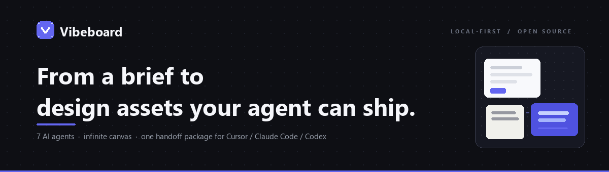
</p>

<h1 align="center">Vibeboard</h1>

<p align="center">
  Write a brief. Seven agents deliver finished visuals on an infinite canvas, then pack them for Cursor, Claude Code, or Codex.
</p>

<p align="center">
  <a href="LICENSE"></a>
  <a href="https://github.com/Zullllkar/vibeboard/stargazers"></a>
  <a href="CHANGELOG.md"></a>
</p>

<p align="center">
  <a href="README.en.md"><strong>English</strong></a>
  &nbsp;·&nbsp;
  <a href="README.zh.md">简体中文</a>
</p>

<p align="center">
  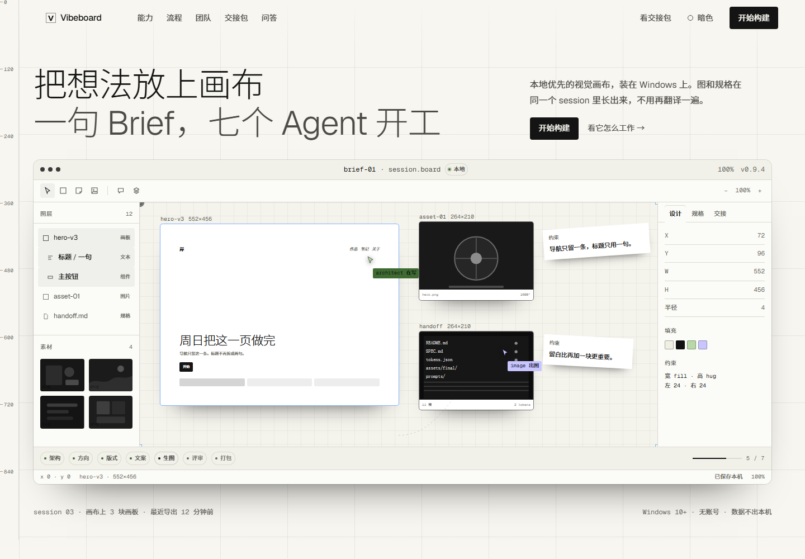
</p>

## What it does

Vibeboard is for developers who can describe a product and need finished visuals before a coding agent writes the UI.

- Finished images land on the canvas, ready to ship.
- Seven agents each own one step: structure, direction, layout, copy, image planning, image generation, and review.
- One handoff folder — PNGs, prompts, design tokens, and the brief — is what Cursor, Claude Code, and Codex read.

## Quick start

Windows 10 64-bit or Windows 11. Download [Vibeboard-0.1.0-x64.zip](https://github.com/Zullllkar/vibeboard/releases/download/v0.1.0/Vibeboard-0.1.0-x64.zip), unzip it, and run `Vibeboard.exe`. The build is unsigned, so SmartScreen may warn about an unknown publisher.

SHA256: `D65FC2AC60BDB2E6FD99D2691997F95A57AE5825E6DD0F42711D7BD309F2652B`

After it opens, add an LLM key in the app (OpenAI, Anthropic, or any OpenAI-compatible provider).

<details>
<summary><b>Run from source</b></summary>

Node.js 20.19+, 22.12+, or 24, plus pnpm 8+.

```bash
git clone https://github.com/Zullllkar/vibeboard.git
cd vibeboard
pnpm install
pnpm dev            # browser debug at http://localhost:3000
pnpm dev:desktop    # desktop window
```

If `pnpm dev` is already running, `pnpm dev:desktop` only opens a window. `pnpm dist:desktop` builds the Windows portable zip.

</details>

<details>
<summary><b>Connect Cursor / Claude Code / Codex</b></summary>

With the app running, open **Settings → Connections**:

- **Cursor** — install via deeplink or write the config.
- **Claude Code** — `claude mcp add --transport http`.
- **Codex** — `codex mcp add --url`, plus headers in `~/.codex/config.toml`.

The coding agent calls `get_handoff` / `get_asset_image` on `http://127.0.0.1:<port>/mcp` (Bearer token, loopback only). The Handoff dialog can also link a code repo and write the package to `design/vibeboard/` with `AGENTS.md` / `CLAUDE.md` snippets.

After a screen is implemented, the agent calls `report_implementation` with a screenshot. A missing image uses `request_asset`. A design question uses `ask_designer`.

Stdio-only hosts can fall back to `node cli.js mcp`.

</details>

<details>
<summary><b>Optional daemon</b></summary>

```bash
# Terminal 1
pnpm daemon

# Terminal 2 — set VAD_DAEMON_URL=http://127.0.0.1:3921 in .env.local
pnpm dev
```

See [Environment Variables](docs/ENVIRONMENT_VARIABLES.md) if you prefer a `.env.local` file over in-app provider settings.

</details>

## Features

<table>
  <tr>
    <td width="33%" valign="top"><b>Infinite canvas</b><br>Brief, assets, spec, and agent status live on one board.</td>
    <td width="33%" valign="top"><b>Seven roles</b><br>Architect, design direction, layout, copy, image plan, image execution, critic.</td>
    <td width="33%" valign="top"><b>Handoff package</b><br>PNG, prompts, tokens, and the brief in one folder.</td>
  </tr>
  <tr>
    <td width="33%" valign="top"><b>Keys stay local</b><br>Providers are configured on your machine. Projects stay on disk.</td>
    <td width="33%" valign="top"><b>Desktop app</b><br>Electron window for daily use. The browser server is there for debugging.</td>
    <td width="33%" valign="top"><b>Open source</b><br>Apache 2.0. Read the pipeline, swap a model, or fork it.</td>
  </tr>
</table>

## See it work

<p align="center">
  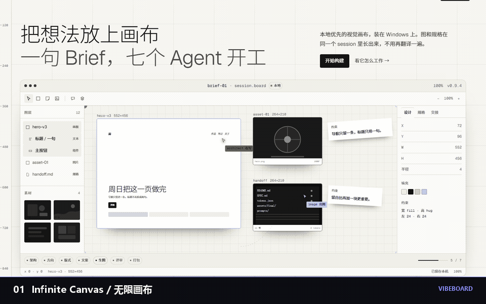
</p>

<details>
<summary>More of the product</summary>

<p align="center">
  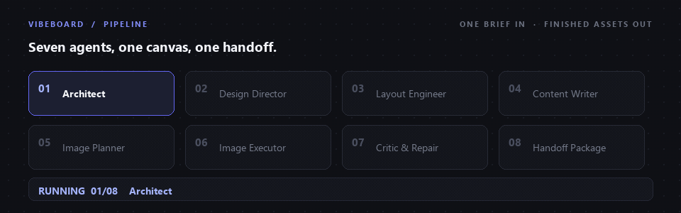
</p>

<table>
  <tr>
    <td width="50%">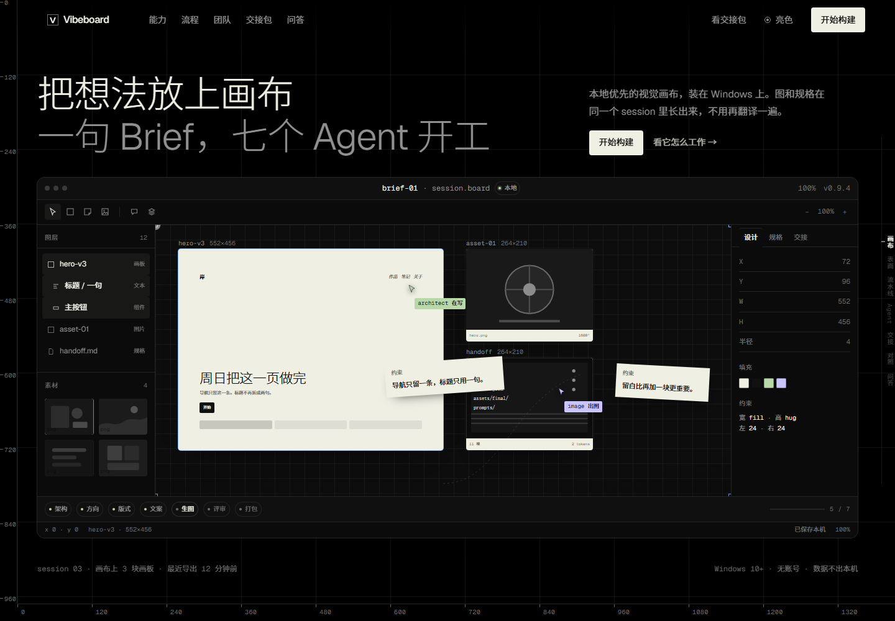</td>
    <td width="50%">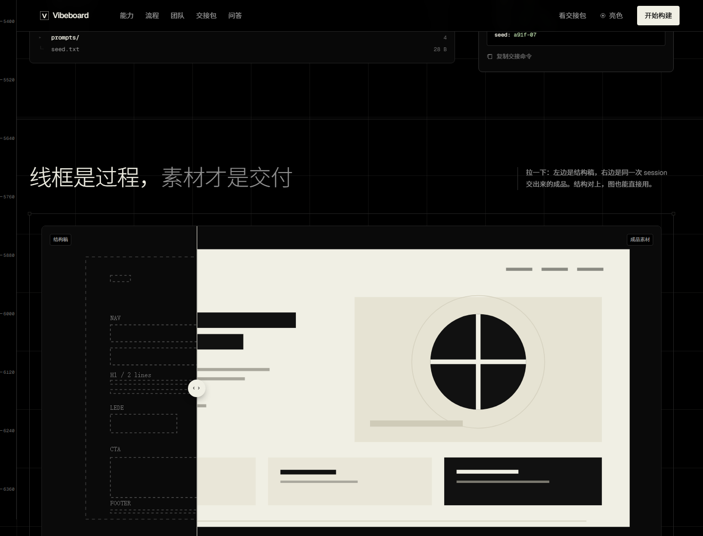</td>
  </tr>
  <tr>
    <td align="center"><sub><b>Dark workspace</b> — the same project, agent status still visible.</sub></td>
    <td align="center"><sub><b>Wireframe to finished asset</b> — structure is the process, the image is the deliverable.</sub></td>
  </tr>
  <tr>
    <td>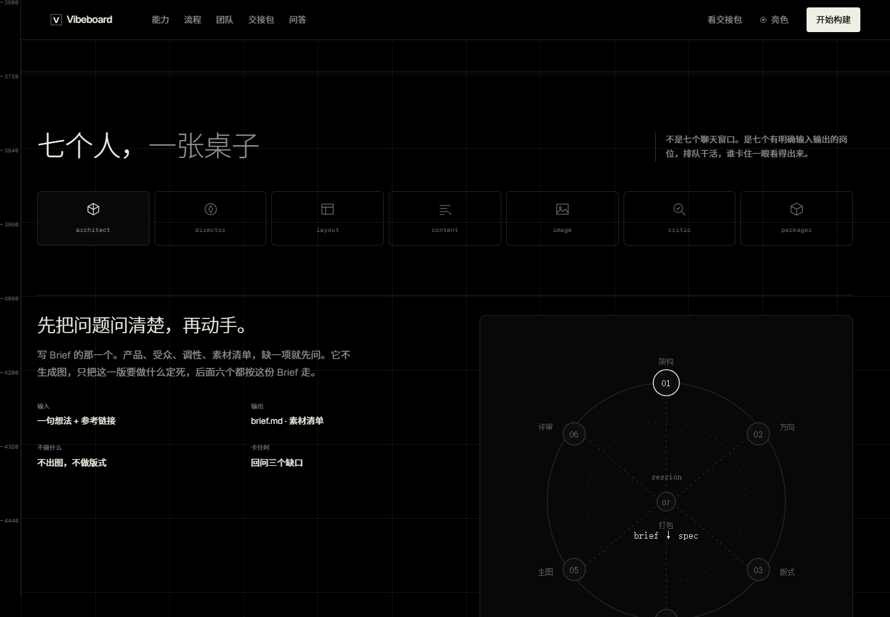</td>
    <td>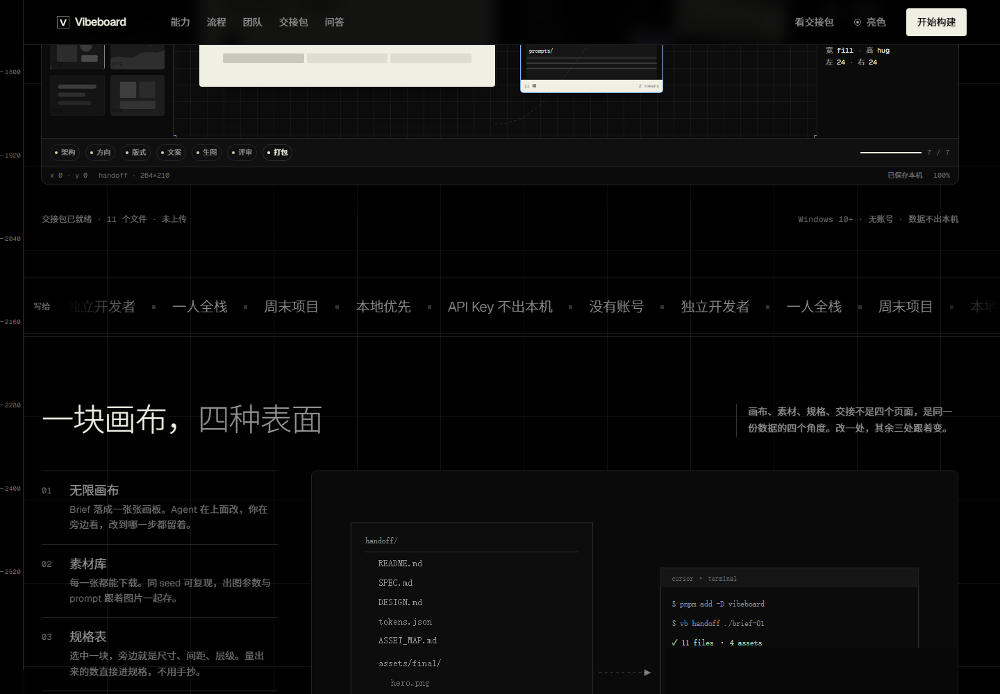</td>
  </tr>
  <tr>
    <td align="center"><sub><b>Seven roles</b> — each agent has an explicit input and output.</sub></td>
    <td align="center"><sub><b>Handoff package</b> — README, spec, tokens.json, and assets/final/.</sub></td>
  </tr>
  <tr>
    <td>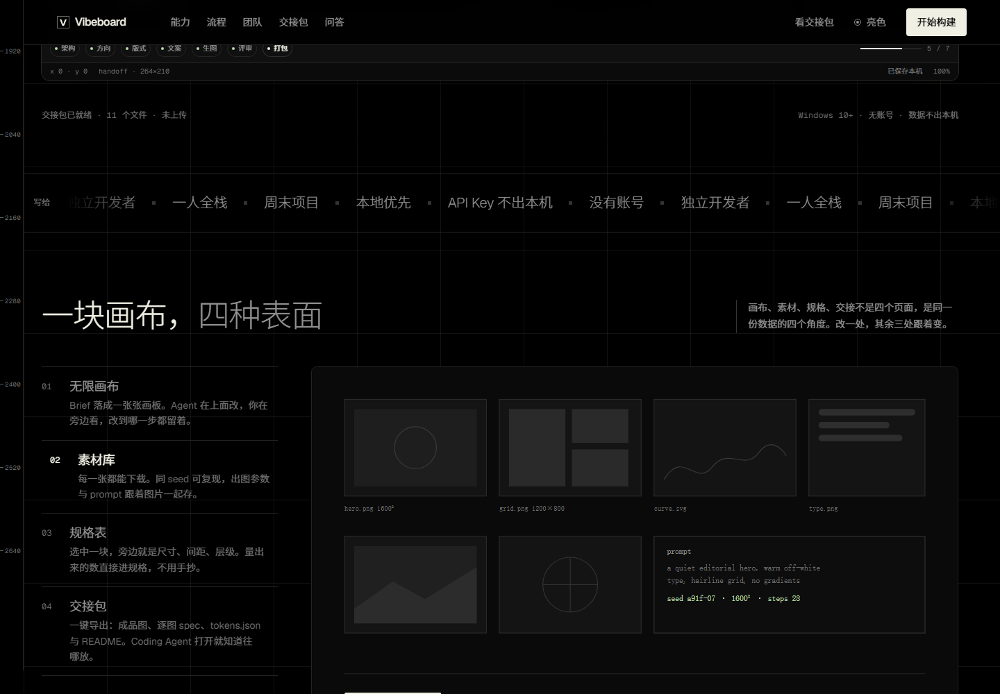</td>
    <td>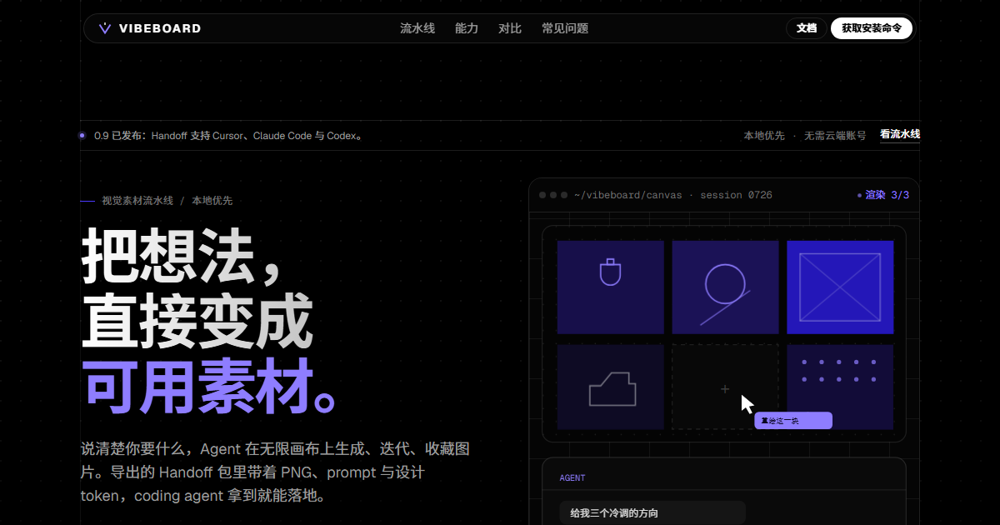</td>
  </tr>
  <tr>
    <td align="center"><sub><b>One canvas, four surfaces</b> — board, assets, specs, and handoff.</sub></td>
    <td align="center"><sub><b>Same pipeline</b> — another visual direction on the live canvas.</sub></td>
  </tr>
</table>

</details>

## How it compares

| | Vibeboard | v0 | Figma AI | Lovart |
|---|---|---|---|---|
| What it outputs | Finished images | Code | Design files | Chat + images |
| Infinite canvas | ✅ tldraw | ❌ | ❌ | ✅ |
| Multi-agent pipeline | ✅ 7 specialized agents | ❌ single pass | ❌ | ~ partial |
| Handoff for coding agents | ✅ PNG + prompts + tokens + context | code only | design files | chat history |
| API keys stay local | ✅ | N/A | ❌ | ❌ |
| Open source | ✅ Apache 2.0 | ❌ | ❌ | ❌ |
| Requires design skills | ❌ | ❌ | ✅ | ❌ |

## How a run works

1. **Write a brief** — name, positioning, audience, platform, visual style, core features.
2. **Agents take their steps** — Architect, design direction, layout, copy, image plan, execution, critic.
3. **Watch the canvas** — assets land on an infinite tldraw board. Rearrange and refine them there.
4. **Export the handoff** — one folder for your coding agent.

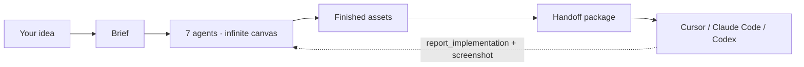

## Documentation

| | |
|:---|:---|
| [Architecture](docs/ARCHITECTURE.md) | [Daemon](docs/DAEMON.md) |
| [Product](PRODUCT.md) | [Design system](DESIGN.md) |
| [Environment variables](docs/ENVIRONMENT_VARIABLES.md) | [Roadmap](ROADMAP.md) |
| [Contributing](CONTRIBUTING.md) | [Changelog](CHANGELOG.md) |

Next.js 16 · React 19 · Tailwind CSS 4 · tldraw 5 · LangGraph · MCP · Zustand · TypeScript 5 · Electron 37. Projects persist under `.vad/projects/`.

## Contributing

Bug reports, feature requests, and pull requests are welcome. Read [CONTRIBUTING.md](CONTRIBUTING.md) and the [Roadmap](ROADMAP.md) first.

## License

[Apache License 2.0](LICENSE) © 2026 Vibeboard.

<details>
<summary>Maintaining this README</summary>

`README.md` is generated from [`README.en.md`](README.en.md) and [`README.zh.md`](README.zh.md) by [`scripts/switch-readme.mjs`](scripts/switch-readme.mjs). Edit a source, then sync:

```bash
pnpm readme:zh     # README.md → 简体中文
pnpm readme:en     # README.md → English
pnpm readme:auto   # detect from the OS locale
pnpm readme:sync   # restore the English default
```

A browser landing page at [docs/index.html](docs/index.html) redirects by `navigator.language` for GitHub Pages or a local open. GitHub itself only follows the language links at the top.

`demo.gif` is composed from workspace screenshots. `pipeline.gif` animates the agent pipeline. Refresh both with `python scripts/build-readme-assets.py` after replacing the source shots.

| Command | Description |
|---------|-------------|
| `pnpm dev` | Next.js dev server |
| `pnpm dev:desktop` | Desktop window (port 18765, data in userData) |
| `pnpm dist:desktop` | Windows portable zip |
| `pnpm dist:desktop:dir` | Unpacked app folder for smoke tests |
| `pnpm daemon` | Persistence daemon (`127.0.0.1:3921`) |
| `pnpm build` / `pnpm start` | Production build and server |
| `pnpm lint` / `pnpm test` | Biome checks and the test suite |

</details>
