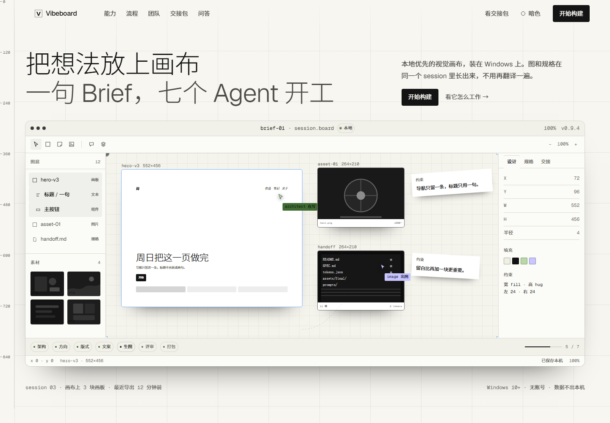
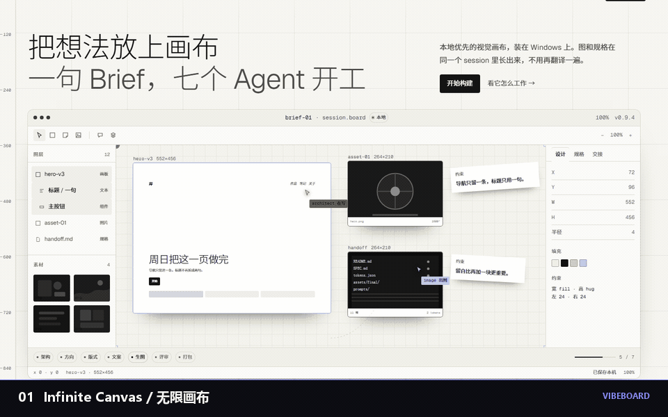
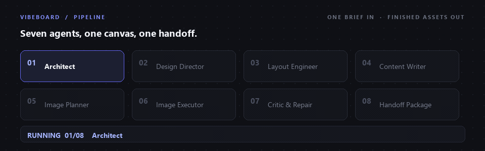
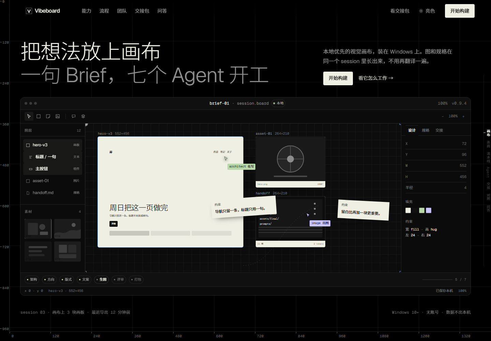
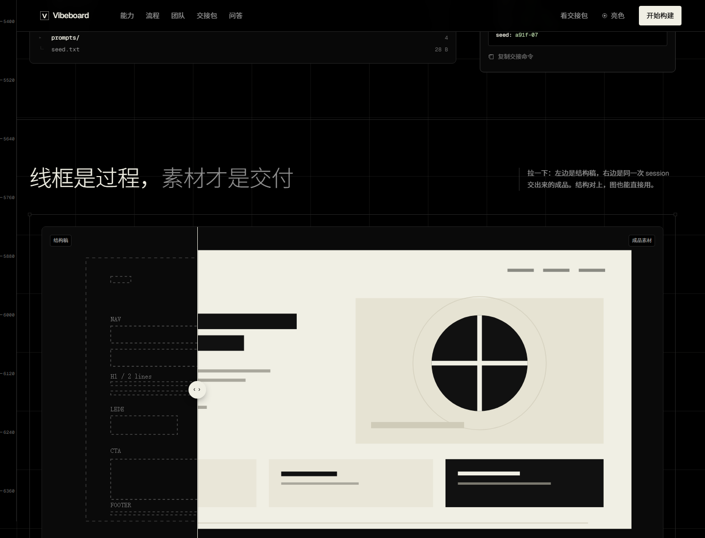
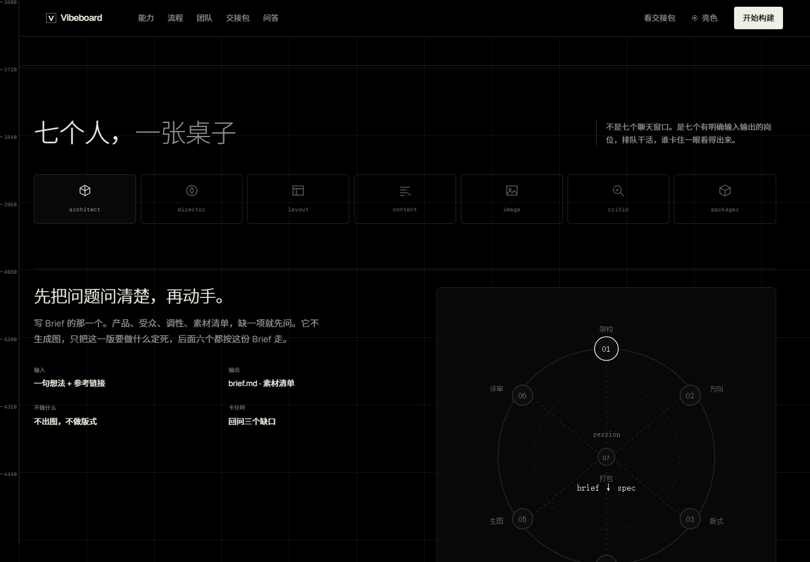
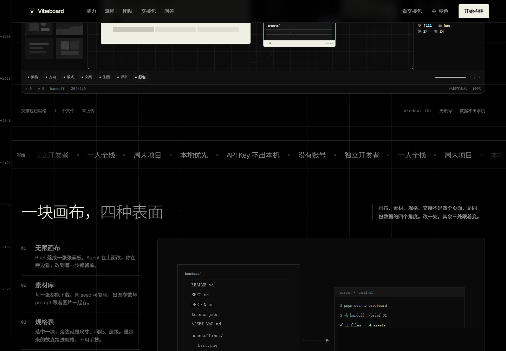
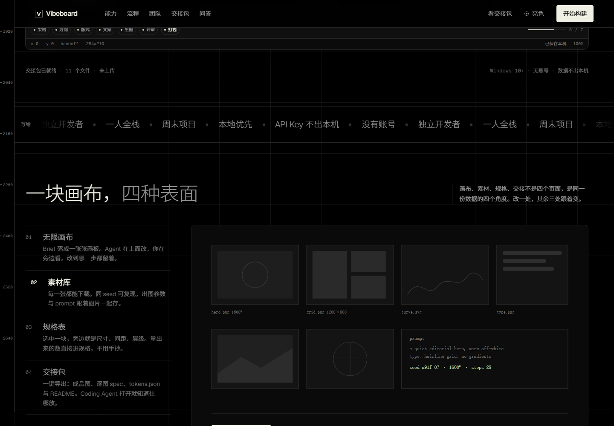
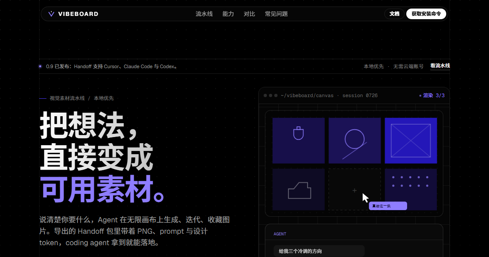
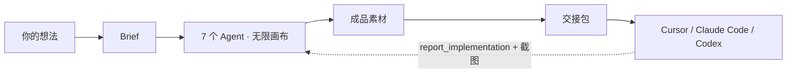

<!-- README 中文源文件。修改本文件后运行 `pnpm readme:sync`。 -->
<!-- 所有相对链接均以仓库根目录为基准。 -->

<p align="center">
  
</p>

<h1 align="center">Vibeboard</h1>

<p align="center">
  写一段 Brief。七个 Agent 在无限画布上交出成品视觉，再打包给 Cursor、Claude Code 或 Codex。
</p>

<p align="center">
  <a href="LICENSE"></a>
  <a href="https://github.com/Zullllkar/vibeboard/stargazers"></a>
  <a href="CHANGELOG.md"></a>
</p>

<p align="center">
  <a href="README.en.md">English</a>
  &nbsp;·&nbsp;
  <a href="README.zh.md"><strong>简体中文</strong></a>
</p>

<p align="center">
  <a href="https://zullllkar.github.io/vibeboard/"><strong>官网</strong></a>
  &nbsp;·&nbsp;
  <a href="https://zullllkar.github.io/vibeboard/vibeboard-download.html"><strong>下载 Windows 版</strong></a>
</p>

<p align="center">
  
</p>

## 它做什么

Vibeboard 给能说清产品、但需要先拿到成品视觉再让 coding agent 写界面的开发者。

- 成品图直接落在画布上，可以拿去用。
- 七个 Agent 各管一步：结构、方向、布局、文案、出图规划、出图、审查。
- 一个交接文件夹——PNG、提示词、设计 token 和 Brief——交给 Cursor、Claude Code、Codex 去读。

## 快速开始

从[官网下载页](https://zullllkar.github.io/vibeboard/vibeboard-download.html)下载 Windows 版。文件是 [Vibeboard-0.1.0-x64.zip](https://github.com/Zullllkar/vibeboard/releases/download/v0.1.0/Vibeboard-0.1.0-x64.zip)，解压后运行 `Vibeboard.exe`。适用于 Windows 10 64 位或 Windows 11。程序未签名，SmartScreen 可能提示未知发布者。

SHA256：`D65FC2AC60BDB2E6FD99D2691997F95A57AE5825E6DD0F42711D7BD309F2652B`

打开后在应用里填写 LLM Key（OpenAI、Anthropic，或任意 OpenAI 兼容接口）。

<details>
<summary><b>贡献者：从源码运行</b></summary>

需要 Node.js 20.19+、22.12+ 或 24，以及 pnpm 8+。

```bash
git clone https://github.com/Zullllkar/vibeboard.git
cd vibeboard
pnpm install
pnpm dev            # 浏览器调试 http://localhost:3000
pnpm dev:desktop    # 桌面窗口
```

`pnpm dev` 已经在跑时，`pnpm dev:desktop` 只再开一个窗口。`pnpm dist:desktop` 打出 Windows 便携 zip。

</details>

<details>
<summary><b>连接 Cursor / Claude Code / Codex</b></summary>

应用运行后打开 **设置 → 连接**：

- **Cursor** — 用 deeplink 安装，或写入配置。
- **Claude Code** — `claude mcp add --transport http`。
- **Codex** — `codex mcp add --url`，并在 `~/.codex/config.toml` 写入 headers。

coding agent 通过 `http://127.0.0.1:<port>/mcp` 调用 `get_handoff` / `get_asset_image`（Bearer token，仅本机回环）。交接弹窗也可以关联代码仓库，把包写到 `design/vibeboard/`，并附上 `AGENTS.md` / `CLAUDE.md` 片段。

页面实现后，agent 用 `report_implementation` 回传截图。缺图用 `request_asset`。设计问题用 `ask_designer`。

只支持 stdio 的宿主可以改用 `node cli.js mcp`。

</details>

<details>
<summary><b>可选：Daemon</b></summary>

```bash
# 终端 1
pnpm daemon

# 终端 2 — 在 .env.local 中设置 VAD_DAEMON_URL=http://127.0.0.1:3921
pnpm dev
```

想用 `.env.local` 而不是应用内配置时，看 [环境变量](docs/ENVIRONMENT_VARIABLES.md)。

</details>

## 功能

<table>
  <tr>
    <td width="33%" valign="top"><b>无限画布</b><br>Brief、素材、规格和 Agent 状态在同一块板上。</td>
    <td width="33%" valign="top"><b>七个角色</b><br>架构、设计方向、布局、文案、出图规划、出图、审查。</td>
    <td width="33%" valign="top"><b>交接包</b><br>PNG、提示词、token 和 Brief 放在一个文件夹里。</td>
  </tr>
  <tr>
    <td width="33%" valign="top"><b>Key 留在本机</b><br>供应商在你的机器上配置。项目写在本地磁盘。</td>
    <td width="33%" valign="top"><b>桌面应用</b><br>日常用 Electron 窗口。浏览器服务用来调试。</td>
    <td width="33%" valign="top"><b>开源</b><br>Apache 2.0。流水线可读，模型可换，也可以 fork。</td>
  </tr>
</table>

## 看它工作

<p align="center">
  
</p>

<details>
<summary>更多画面</summary>

<p align="center">
  
</p>

<table>
  <tr>
    <td width="50%"></td>
    <td width="50%"></td>
  </tr>
  <tr>
    <td align="center"><sub><b>深色工作台</b> — 同一个项目，Agent 状态仍然可见。</sub></td>
    <td align="center"><sub><b>线框到成品</b> — 结构是过程，交付的是图。</sub></td>
  </tr>
  <tr>
    <td></td>
    <td></td>
  </tr>
  <tr>
    <td align="center"><sub><b>七个角色</b> — 每个 Agent 有明确的输入和输出。</sub></td>
    <td align="center"><sub><b>交接包</b> — README、spec、tokens.json 和 assets/final/。</sub></td>
  </tr>
  <tr>
    <td></td>
    <td></td>
  </tr>
  <tr>
    <td align="center"><sub><b>一块画布，四个表面</b> — 画板、素材、规格、交接。</sub></td>
    <td align="center"><sub><b>同一条流水线</b> — 实时画布上的另一种视觉方向。</sub></td>
  </tr>
</table>

</details>

## 和别的工具差在哪

| | Vibeboard | v0 | Figma AI | Lovart |
|---|---|---|---|---|
| 产出 | 成品图 | 代码 | 设计文件 | 对话 + 图片 |
| 无限画布 | ✅ tldraw | ❌ | ❌ | ✅ |
| 多 Agent 流水线 | ✅ 7 个专职 Agent | ❌ 单次生成 | ❌ | ~ 部分 |
| 给 coding agent 的交接 | ✅ PNG + 提示词 + token + 上下文 | 只有代码 | 设计文件 | 聊天记录 |
| API Key 留在本地 | ✅ | 不适用 | ❌ | ❌ |
| 开源 | ✅ Apache 2.0 | ❌ | ❌ | ❌ |
| 需要设计基础 | ❌ | ❌ | ✅ | ❌ |

## 怎么跑通

1. **写 Brief** — 名称、定位、用户、平台、视觉风格、核心功能。
2. **Agent 按步骤做** — 架构、设计方向、布局、文案、出图规划、出图、审查。
3. **在画布上看** — 素材落在无限 tldraw 画板上，就地调整。
4. **导出交接包** — 一个文件夹交给 coding agent。



## 文档

| | |
|:---|:---|
| [官网](https://zullllkar.github.io/vibeboard/) | [下载 Windows 版](https://zullllkar.github.io/vibeboard/vibeboard-download.html) |
| [架构](docs/ARCHITECTURE.md) | [Daemon](docs/DAEMON.md) |
| [产品](PRODUCT.md) | [设计系统](DESIGN.md) |
| [环境变量](docs/ENVIRONMENT_VARIABLES.md) | [路线图](ROADMAP.md) |
| [贡献](CONTRIBUTING.md) | [更新日志](CHANGELOG.md) |

Next.js 16 · React 19 · Tailwind CSS 4 · tldraw 5 · LangGraph · MCP · Zustand · TypeScript 5 · Electron 37。项目落在 `.vad/projects/`。

## 贡献

欢迎提 bug、功能请求和 pull request。先看 [CONTRIBUTING.md](CONTRIBUTING.md) 和 [路线图](ROADMAP.md)。

## 许可证

[Apache License 2.0](LICENSE) © 2026 Vibeboard。

<details>
<summary>维护这份 README</summary>

`README.md` 由 [`scripts/switch-readme.mjs`](scripts/switch-readme.mjs) 从 [`README.en.md`](README.en.md) 和 [`README.zh.md`](README.zh.md) 生成。改源文件后再同步：

```bash
pnpm readme:zh     # README.md → 简体中文
pnpm readme:en     # README.md → English
pnpm readme:auto   # 按系统语言选择
pnpm readme:sync   # 恢复英文默认
```

产品官网是 [zullllkar.github.io/vibeboard](https://zullllkar.github.io/vibeboard/)。[docs/index.html](docs/index.html) 只负责切换 README 语言。GitHub 仓库页本身只认顶部的语言链接。

`demo.gif` 由工作台截图合成。`pipeline.gif` 演示 Agent 流水线。换过素材图后运行 `python scripts/build-readme-assets.py` 重新生成。

| 命令 | 作用 |
|---------|-------------|
| `pnpm dev` | Next.js 开发服务器 |
| `pnpm dev:desktop` | 桌面窗口（端口 18765，数据在 userData） |
| `pnpm dist:desktop` | Windows 便携 zip |
| `pnpm dist:desktop:dir` | 未打包目录，用来冒烟 |
| `pnpm daemon` | 持久化守护进程（`127.0.0.1:3921`） |
| `pnpm build` / `pnpm start` | 生产构建与启动 |
| `pnpm lint` / `pnpm test` | Biome 检查和测试 |

</details>
